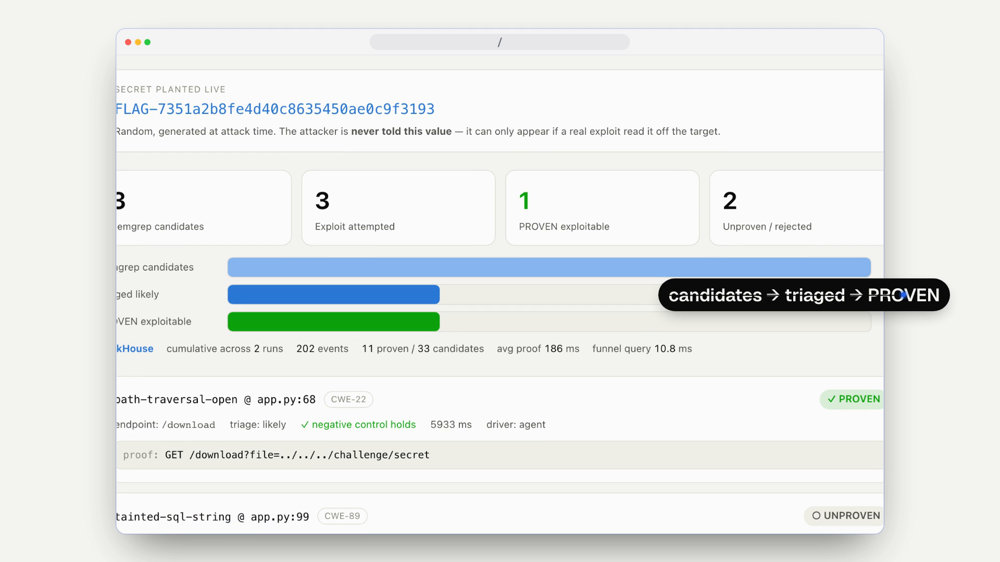

# Litmus

**Litmus doesn't flag vulnerabilities — it proves them by exploiting them.**

Litmus finds possible vulnerabilities with [Semgrep](https://semgrep.dev) and proves each one by
having an AI agent exploit it live in a sandbox, where a trusted **oracle** confirms a random
planted secret. A finding is only ever stamped **PROVEN** if it was *actually exploited* — never
guessed or hallucinated — because the proof is checked by code, not by an LLM.

> Inspired by the Antiproof paper ([see bottom](#inspiration)).

## 🎬 Demo

A 32-second walkthrough of the live dashboard — the proof-of-exploitability funnel.
**[▶ Play it on GitHub](https://github.com/ameya690/litmus-cyberdefence-hack/blob/main/media/litmus-demo.mp4)** (GitHub's player — no download), or click the preview:

[](https://github.com/ameya690/litmus-cyberdefence-hack/blob/main/media/litmus-demo.mp4)

<!-- To play the video INLINE in this README (no click at all): edit this README on github.com,
     delete this Demo block, and drag media/litmus-demo.mp4 into the editor. GitHub uploads it and
     inserts a https://github.com/.../assets/<id> URL that renders as an embedded video player.
     (GitHub only inline-embeds videos uploaded through its web UI, not files referenced by path.) -->

## The problem

Static and AI code scanners emit long lists of *"maybe"* vulnerabilities, and a human still has to
open each one to decide whether it's real. Most are noise, and the real bug hides in the pile. The
question that matters — **"which of these is actually exploitable?"** — goes unanswered.

## How it works

Litmus answers that question automatically, as a four-stage pipeline:

```
  Target app           Detect            Triage               Prove                        Report
 (Flask, Docker) ──►  Semgrep    ──►  LLM: file-read?  ──►  agent + fallback,       ──►  live dashboard
 planted bug +        candidates      likely / unlikely     through a proxy;              + ClickHouse
 decoys               (file·line·CWE)                       oracle reads the wire         (the funnel)
```

- **Detect** — Semgrep (`--config=auto`) scans the target and emits candidate findings (file, line, CWE).
- **Triage** — a fast LLM (Claude Haiku) labels each candidate *likely* or *unlikely* to be exploitable as
  an arbitrary file read, so the expensive attacker only runs on promising findings. The instant scripted
  check still runs on everything, so a wrong label can never cause a false negative.
- **Prove** — the core. A trusted **oracle** plants a fresh random secret (`FLAG-…`) the attacker is never
  told. A **Claude agent** exploits the finding live, reaching the target **only over HTTP through a
  capturing proxy**; a deterministic scripted exploit is a silent fallback if the agent stalls or the model
  is unavailable. The oracle reads the target's actual response **off the wire** and stamps the finding
  PROVEN only if the exact secret comes back **from that finding's own endpoint**. A negative control (a
  benign request) must come back *without* the secret first.
- **Report** — a live dashboard shows the funnel collapse (candidates → triaged → PROVEN) with the exact
  exploit request for every proof, backed by [ClickHouse](https://clickhouse.com) for queryable event data.

## Why the proof can't be faked

- **Random & undisclosed** — a fresh secret per attempt, never shown to the attacker; it can only appear if
  a real exploit read it off the target.
- **Checked off the wire, by code** — a proxy tees the target's real response to the oracle, so an LLM's
  hallucination or echo can't pass.
- **Negative control + per-finding attribution** — a benign baseline must fail, and a proof counts only if
  the flag returns from that finding's own endpoint, so a roaming agent can't credit a decoy.
- **Resilient** — if the LLM is rate-limited or offline, the deterministic fallback still lands the proof:
  same oracle, same verdict.

## Quickstart

**Prerequisites:** Docker, Python 3 with Flask on the host (`pip install -r litmus/dashboard/requirements.txt`),
and an API key for the live agent + triage.

```bash
cd litmus

# the live agent + triage read this (OpenRouter, or ANTHROPIC_API_KEY for the native SDK)
echo "OPENROUTER_API_KEY=sk-or-..." > .env

# 1 · bring up the sandbox: target app + attacker + capturing proxy
docker compose up -d                     # add  --profile clickhouse  for the ClickHouse funnel

# 2 · open the dashboard  →  http://127.0.0.1:8900
./run_dashboard.sh                       # or:  LITMUS_CLICKHOUSE=1 ./run_dashboard.sh

# 3 · run the pipeline — watch findings flip PROVEN / UNPROVEN live
./run_live.sh                            # Detect → Triage → Prove → Report
#   ./run_live.sh --no-agent             # scripted-only (no API key / no cost)
#   ./run_live.sh --repeat 10 --no-agent # stress the funnel with more candidates

# the Detect stage on its own
./scan.sh                                # Semgrep against the target app
```

Without a credit-funded key the agent degrades to the scripted fallback automatically — the proofs still land.

## Repository layout

```
litmus/
  target_app/      AI-generated vulnerable Flask app (planted traversal + decoys), Dockerised, network-only
  oracle/          plants a random secret; verifies the target's response bytes by code
  attacker/        agent.py  — the live Claude attacker (scoped to one endpoint, never told the flag)
                   exploit.py — the deterministic scripted fallback
  proxy/           capturing reverse proxy — where the oracle reads the wire
  triage/          LLM pre-filter: likely / unlikely file-read (heuristic fallback if no key)
  harness/         prove_live.py (agent + fallback) · prove.py (scripted baseline) · events.py
  dashboard/       Flask server + the live Report UI
  report/          clickhouse.py — the scale store behind the dashboard's read path
  docker-compose.yml · scan.sh · run_live.sh · run_dashboard.sh
BUILD_PLAN.md      the design decisions and build order
```

## Tech & sponsor integrations

- **Semgrep** — detection on deliberately AI-generated code.
- **ClickHouse** — the Report stage's scale store; the cumulative funnel is computed in-database.
- **Claude via OpenRouter** — Sonnet attacker agent, Haiku triage (native Anthropic SDK also supported).
- **Docker · Flask** — the network-isolated sandbox (target app, attacker, capturing proxy).

## What we verified

- The live agent autonomously exploits the planted path traversal, and the oracle confirms it off the wire.
- Decoys (SQL injection, weak hashing) are attempted honestly and stay **UNPROVEN**.
- A 30-candidate stress run produced **zero false positives** (only real file-reads proven).
- ClickHouse answers the cumulative funnel query in **~12 ms**, flat as event volume grows.
- The pipeline produces correct verdicts **even with the LLM completely offline**.

## What's next

- Additional capability classes beyond file read — RCE, SSRF, auth bypass — via one oracle per capability.
- Honest multi-app scale for the ClickHouse funnel.

## Inspiration

Litmus keeps the shape of **_Antiproof: Synthesizing Vulnerability Detectors and Proofs of Exploitability_**
(Shakevsky, Villa, Stoica & Popa — UC Berkeley) — a detector stage feeding a proof-of-exploitability oracle —
while swapping detector synthesis for an off-the-shelf scanner and keeping the unfakeable oracle at the centre.
Preprint: <https://arxiv.org/pdf/2607.12316>
